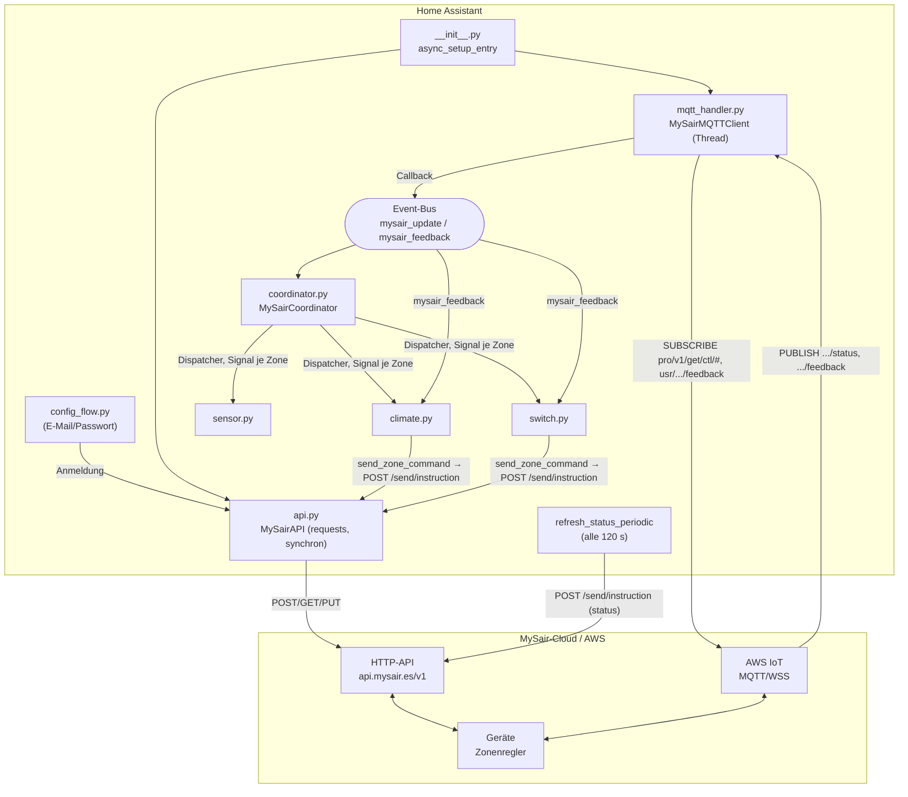
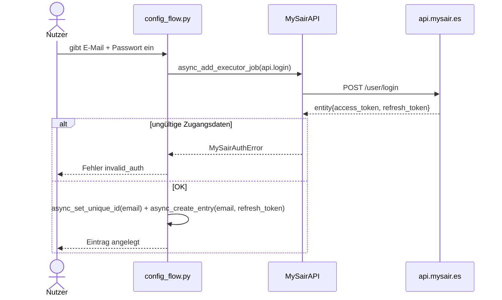
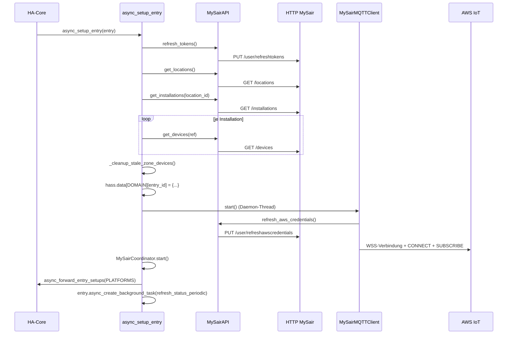
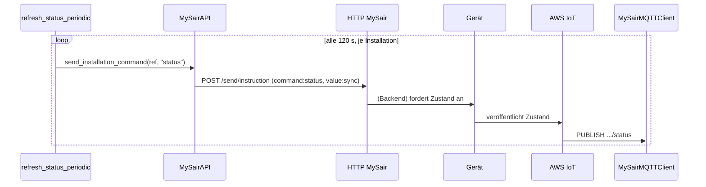
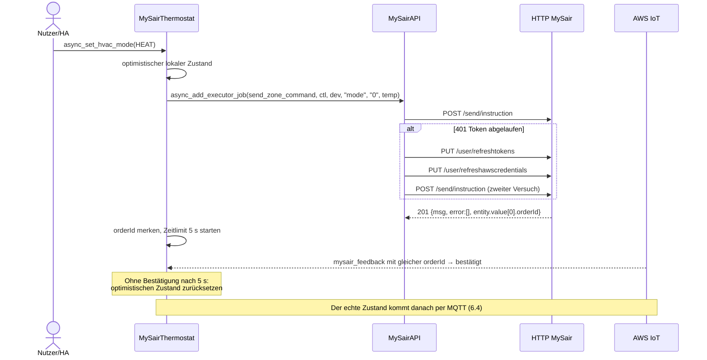
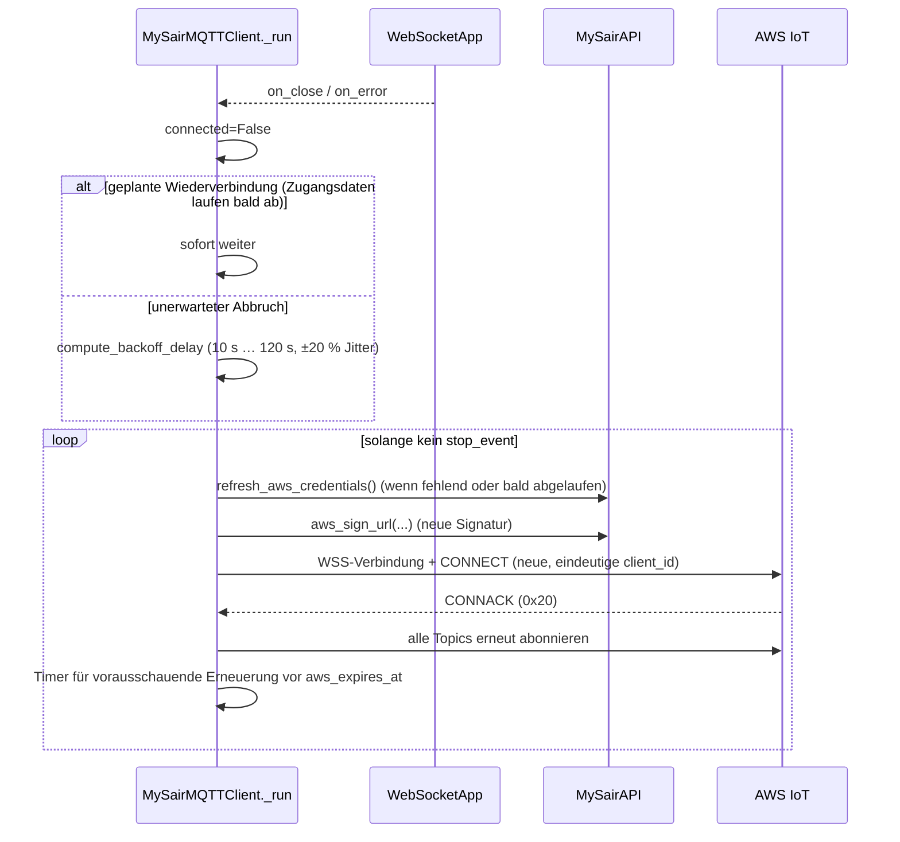

# Architektur – MySair-Integration für Home Assistant

> Gewissheitsstufen in diesem Dokument:
> **Bestätigt** (im Code nachgelesen) · **Abgeleitet** (aus dem Ablauf geschlossen) · **Hypothese** (plausibel, ohne direkten Beleg) · **Unbekannt** (nur mit echtem Gerät zu klären).
> Code-Verweise nennen Datei und Funktion statt Zeilennummern, da sich Zeilen bei jeder Änderung verschieben.

---

## 1. Systemüberblick

MySair ist ein cloudgesteuertes **Klima-Zonensystem** (Klimaanlage und/oder Fußbodenheizung bzw. -kühlung, je Zone kombinierbar – siehe Feld `m` in `docs/protocol-findings.md` §4). Diese Integration (Custom Component, Domain `mysair`) ermöglicht Home Assistant:

- die Anmeldung an der HTTP-API von MySair (`https://api.mysair.es/v1`) – **Bestätigt** (`api.py`, `MySairAPI`);
- das Erkennen des Aufbaus: *Standorte → Installationen → Geräte (Thermostate/Zonen)* – **Bestätigt** (`__init__.py`, `async_setup_entry`);
- den Empfang des Zustands in Echtzeit per **MQTT über WebSocket** von AWS IoT – **Bestätigt** (`mqtt_handler.py`);
- das Senden von Befehlen (Ein/Aus, Temperatur, Modus, Lüfterstufe) per HTTP `POST /send/instruction` – **Bestätigt** (`api.py`, `send_instruction`, `send_zone_command`).

Deklarierte `iot_class`: `cloud_push` (`manifest.json`). In der Praxis ist es ein *Cloud-Push mit zusätzlicher Abfrage*: Der Zustand **kommt** per MQTT (Push), wird aber zusätzlich alle 120 s per HTTP-`POST` **angestoßen** (`refresh_status_periodic` in `__init__.py`).

### Zentrale Architekturtatsache (Bestätigt)
Befehle werden **nicht per MQTT veröffentlicht**. Der MQTT-Client sendet nur `CONNECT` und `SUBSCRIBE`, nie `PUBLISH`. Jeder Befehl geht per HTTP an `/send/instruction`; das MySair-Backend leitet ihn an die Geräte weiter und liefert den Zustand per MQTT zurück. Die MQTT-Verbindung ist **reiner Empfang**.

---

## 2. Aufbau des Repositorys

```
ha-mysair/
├── custom_components/mysair/     # Paket der Integration (Standardlayout HA/HACS)
│   ├── __init__.py               # Setup/Unload, MQTT-Callback, periodische Abfrage, Dienst
│   ├── api.py                    # MySairAPI: synchrones HTTP (requests) + AWS-SigV4-Signatur
│   ├── status_parser.py          # Reine Parser für 'status' und 'feedback' (ohne HA-Abhängigkeit)
│   ├── mqtt_handler.py           # MySairMQTTClient: MQTT von Hand über WebSocket
│   ├── coordinator.py            # MySairCoordinator: verteilt Zustände je Zone
│   ├── command_feedback.py       # Bestätigung von Befehlen über das feedback-Topic
│   ├── availability.py           # Verfügbarkeit nach Aktualität der MQTT-Daten
│   ├── device.py                 # Gemeinsame Geräteinformationen je Zone/Konto
│   ├── climate.py                # MySairThermostat (ClimateEntity)
│   ├── sensor.py                 # 4 Sensoren je Zone + Sensor „Cloud-Verbindung“
│   ├── switch.py                 # Ein/Aus und Fußbodenheizung je Zone
│   ├── config_flow.py            # Einrichtungsdialog (E-Mail + Passwort), Reauth
│   ├── diagnostics.py            # Diagnose-Download mit geschwärzten Zugangsdaten
│   ├── const.py                  # Konstanten
│   ├── services.yaml             # Schema des Dienstes mysair.stop_installation
│   ├── strings.json, translations/, icons.json, brand/
│   └── manifest.json
├── tests/                        # Tests ohne HA (P0/P1) und mit HA-Testumgebung (P2/P3)
├── docs/                         # diese Dokumentation
├── Dockerfile.test · docker-compose.yml · pytest.ini · pyproject.toml
└── README.md · CLAUDE.md · CHANGELOG.md · LICENSE · hacs.json
```

---

## 3. Komponenten und Zuständigkeiten

| Komponente | Datei | Aufgabe | Thread/Loop |
|---|---|---|---|
| `async_setup_entry` | `__init__.py` | Steuert Sitzungserneuerung → Erkennung → MQTT → Koordinator → Plattformen → periodische Abfrage | Event-Loop + Executor |
| `mqtt_message_callback` | `__init__.py` | Wertet `status` und `feedback` aus, feuert `mysair_update` bzw. `mysair_feedback` | MQTT-Thread → `call_soon_threadsafe` |
| `refresh_status_periodic` | `__init__.py` | Fordert alle 120 s per HTTP den Zustand jeder Installation an | Hintergrund-Task der Config Entry |
| `MySairAPI` | `api.py` | Anmeldung, Token-Erneuerung, AWS-Zugangsdaten, Erkennung, Befehle, SigV4-Signatur | Executor (blockierend) |
| `MySairMQTTClient` | `mqtt_handler.py` | WSS-Verbindung, CONNECT/SUBSCRIBE von Hand, Wiederverbindung mit Backoff, vorausschauende Erneuerung der Zugangsdaten | eigener Daemon-Thread |
| `MySairCoordinator` | `coordinator.py` | Hört **einmal** je Config Entry auf `mysair_update`, filtert nach eigener Installation und verteilt jede Zone einzeln über `homeassistant.helpers.dispatcher` | Event-Loop |
| Entitäten | `climate.py`, `sensor.py`, `switch.py` | Abonnieren das Dispatcher-Signal ihrer Zone (`signal_zone_update`) und aktualisieren ihren Zustand | Event-Loop |

### Abhängigkeiten zwischen Modulen (Bestätigt)

```
config_flow.py ─► api.py (Anmeldung)
__init__.py ─► api.py, mqtt_handler.py, status_parser.py, coordinator.py, const.py
mqtt_handler.py ─► api.py (AWS-Zugangsdaten, aws_sign_url)
climate/sensor/switch.py ─► coordinator.py (Signal), device.py, availability.py, command_feedback.py
```

Die Entitäten kennen `MySairMQTTClient` **nicht** direkt. Der Weg ist: MQTT-Thread → Event-Bus (`mysair_update`) → `MySairCoordinator` (einziger Abonnent je Config Entry) → Dispatcher-Signal je Zone → Entität. **Bestätigt.**

---

## 4. Datenherkunft: HTTP oder MQTT

| Daten | Herkunft | Beleg |
|---|---|---|
| Sitzungstoken | HTTP `PUT /user/refreshtokens` (bei Einrichtung/Reauth: `POST /user/login`) | `api.py`: `refresh_tokens`, `login` |
| AWS-IoT-Zugangsdaten | HTTP `PUT /user/refreshawscredentials` | `api.py`: `refresh_aws_credentials` |
| Standorte / Installationen / Geräte | HTTP `GET /locations`, `/installations`, `/devices` | `api.py`: `get_locations`, `get_installations`, `get_devices` |
| Zustand der Zonen (Temperaturen, Grenzwerte, Modus, Feuchte, Lüfter, Fähigkeiten) | **MQTT**-Topic `.../status` | `status_parser.parse_status_payload` |
| Befehlsbestätigung | **MQTT**-Topic `.../usr/{aws_mqtt_user}/feedback` | `status_parser.parse_feedback_payload` |
| Befehle (temp, mode, power, fanspeed, stop) | HTTP `POST /send/instruction` | `api.py`: `send_zone_command`, `send_installation_command` |
| Anstoß einer Zustandsmeldung | HTTP `POST /send/instruction` (`command:status`) | `refresh_status_periodic` |

**Abgeleitet:** Der Aufbau (Zonennamen) wird nur beim Start bzw. Neuladen per HTTP geholt; veränderliche Werte kommen nur per MQTT. Bis zum ersten Status sind die Entitäten „nicht verfügbar“ (`availability.py`).

---

## 5. Übersichtsdiagramm



---

## 6. Sequenzdiagramme

### 6.1 Ersteinrichtung (Config Flow)



Das Passwort wird nur während des Dialogs im Speicher gehalten und nie in der Config Entry gespeichert. Siehe `docs/security-and-privacy.md`.

### 6.2 Start von Home Assistant (Setup Entry)



Fehlerfälle: Eine ungültige Sitzung führt zu `ConfigEntryAuthFailed` (HA bietet die erneute Anmeldung an), Netz- oder Backend-Fehler zu `ConfigEntryNotReady` (HA versucht es später erneut).

### 6.3 Zustandsabfrage (angestoßen)



### 6.4 Empfang einer MQTT-Aktualisierung

```mermaid
sequenceDiagram
    participant IOT as AWS IoT
    participant M as MySairMQTTClient._on_message
    participant CB as mqtt_message_callback
    participant BUS as Event-Bus
    participant CO as MySairCoordinator
    participant E as Entität (climate/sensor/switch)
    IOT->>M: binärer WSS-Frame (PUBLISH 0x30)
    M->>M: Puffer zusammensetzen, parse_mqtt_publish → Topic + JSON
    M->>CB: callback({topic, payload})
    CB->>CB: parse_status_payload (';' am Ende entfernen, t[] auswerten)
    CB->>BUS: call_soon_threadsafe(async_fire, mysair_update, {topic, data})
    BUS->>CO: _handle_update(event) (einziger Abonnent)
    CO->>CO: ctl in installation_refs prüfen, nach Zone aufteilen
    CO->>E: async_dispatcher_send(signal_zone_update(ctl, zone_id), zone)
    E->>E: _handle_zone_update(zone): Zustand setzen + async_write_ha_state()
```

### 6.5 Befehl aus einer Entität



Hinweis: `send_instruction` erwartet derzeit `msg == "Creado"`. Das Backend antwortet je nach Kontosprache auch mit `"Created"`; dieser Fall wird noch fälschlich als Ablehnung gewertet (siehe `docs/mysair-http-api.md` §3.1).

### 6.6 Wiederverbindung nach MQTT-Abbruch



---

## 7. Beobachtete technische Entscheidungen

| Entscheidung | Beleg | Kommentar |
|---|---|---|
| **Synchroner** HTTP-Client (`requests`) im Executor | `api.py`, Aufrufe über `async_add_executor_job` | Blockiert den Loop nicht; erlaubt eine injizierbare `session` für Tests. |
| MQTT **von Hand** über WebSocket statt `paho-mqtt` | `mqtt_handler.py` | Bewusst beibehalten: `paho-mqtt` unterstützt keine SigV4-signierte WSS-URL, die vor jeder Wiederverbindung neu signiert werden muss (siehe `docs/development-roadmap.md`, E6). |
| Event-Bus + zentraler Koordinator + Dispatcher | `coordinator.py` | Ein Abonnent je Config Entry statt einer Filterung in jeder Entität. |
| **Optimistischer** Zustand mit Rücksetzung | `command_feedback.py` | Wird zurückgesetzt, wenn nach 5 s keine Bestätigung kommt; ein echter Status hat Vorrang. |
| Kein `DataUpdateCoordinator` | – | Reines Push-Muster; `DataUpdateCoordinator` ist für Abfragen gedacht. |
| Eigene AWS-SigV4-Signatur | `api.py`: `aws_sign_url` | Vermeidet `boto3` als schwere Abhängigkeit. |

---

## 8. Offene Punkte (Kurzfassung)

- Vollständige Struktur der HTTP-Antworten (Felder von `location`, `installation`, `device`). **Unbekannt** – genutzt werden nur `id`, `reference`, `name`. Siehe `docs/mysair-http-api.md`.
- Bedeutung der Zonenfelder `vf`, `hmh`, `mh`, `p`, `ps`. **Unbekannt**. Siehe `docs/known-unknowns.md`.
- Ratenbegrenzung von `/send/instruction`. **Unbekannt**.
- Weitere Topics außer `.../status` und `.../feedback`. Bisher keine beobachtet.

Querverweise: `docs/mysair-http-api.md`, `docs/mysair-mqtt-protocol.md`, `docs/domain-model.md`, `docs/home-assistant-integration.md`, `docs/testing-strategy.md`, `docs/security-and-privacy.md`, `docs/known-unknowns.md`, `docs/development-roadmap.md`.
