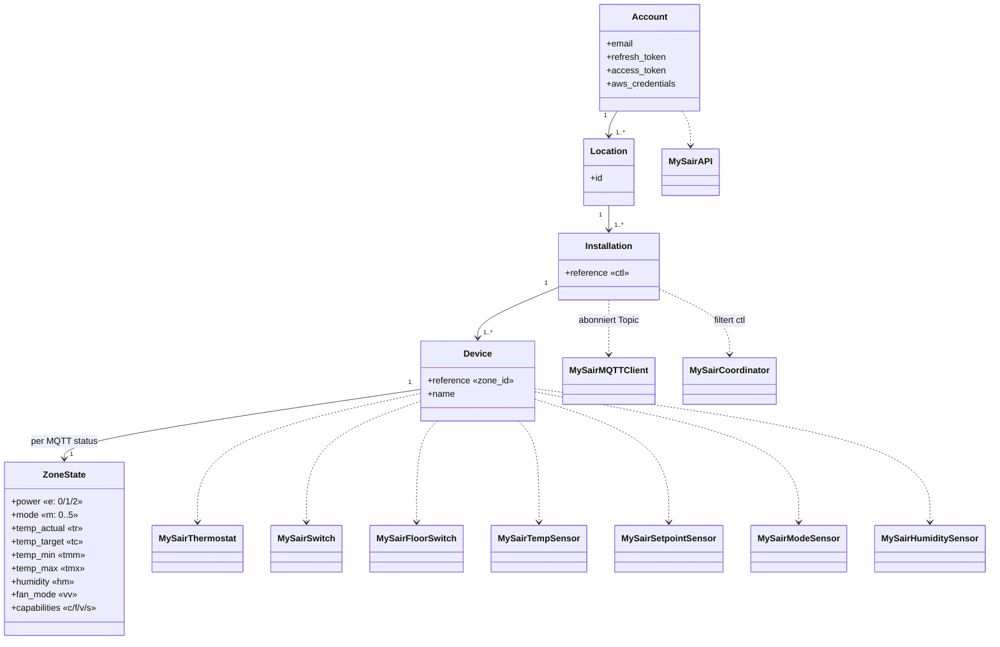

# Domänenmodell von MySair

> Begriffliche Rekonstruktion aus dem Code und der offiziellen App. Gewissheit je Element angegeben.

---

## 1. Begriffshierarchie (Bestätigt durch den Erkennungsablauf)

```
Konto (E-Mail, refresh_token)
  └── Location (Standort)              GET /locations            → id
        └── Installation (Anlage)      GET /installations        → reference  (== ctl == Controller)
              └── Device (Zone/Thermostat)  GET /devices         → reference, name
                    └── Zustand (per MQTT)  .../status → t[]      → e, m, tr, tc, tmm, tmx, hm, vv, sv, Fähigkeiten
```

**Beobachtungen (Bestätigt):**
- Die Integration nutzt **nur die erste `Location`** (`async_setup_entry`, bewusste Abgrenzung).
- **Alle** Installationen dieses Standorts werden geladen.
- `Installation.reference` hat drei Rollen: `ctl` in Befehlen, Teil des MQTT-Topics und Kennung der Installation (auch für den Dienst `mysair.stop_installation`).
- Ein `Device` = eine **Zone** = ein **Thermostat**; die Begriffe werden im Code gleichbedeutend verwendet.

---

## 2. Klassendiagramm (begrifflich + Umsetzung)



---

## 3. Interne Modelle

| Modell | Eigene Klasse? | Tatsächliche Darstellung | Ort |
|---|---|---|---|
| Account | Nein | Attribute von `MySairAPI` (`email`, `access_token`, `refresh_token_value`, `aws_credentials`, `entity`); in der Config Entry nur `email` + `refresh_token` | `api.py`, `config_flow.py` |
| Location | Nein | `dict` mit `id`, nur während des Setups | `async_setup_entry` |
| Installation | Nein | `str` (`reference`) in der Liste `installation_refs` | `async_setup_entry` |
| Device | Nein | `dict` in `all_devices[ref]`, gelesen werden `reference`/`name` | `async_setup_entry` |
| ZoneState | Nein | normalisiertes `dict` aus `parse_status_payload`, über den Koordinator je Zone verteilt | `status_parser.py`, `coordinator.py` |

> Es gibt **keine Dataclasses oder typisierten Modelle**; alles sind `dict`/`str`/`list`. **Bestätigt.** Das ist technische Schuld, aber derzeit ohne praktische Folgen.

---

## 4. Abbildung MySair → Home-Assistant-Entitäten

| MySair-Begriff | HA-Entität (Klasse) | unique_id | Plattform | Gewissheit |
|---|---|---|---|---|
| Device (Zone) | `MySairThermostat` | `mysair_{ctl}_{dev}` | climate | Bestätigt |
| Zone – Ein/Aus | `MySairSwitch` | `mysair_switch_{ctl}_{dev}` | switch | Bestätigt |
| Zone – Fußbodenheizung | `MySairFloorSwitch` | `mysair_floor_{ctl}_{dev}` | switch | Bestätigt |
| Zone – aktuelle Temperatur | `MySairTempSensor` | `mysair_temp_{ctl}_{dev}` | sensor | Bestätigt |
| Zone – Soll-Temperatur | `MySairSetpointSensor` | `mysair_setpoint_{ctl}_{dev}` | sensor | Bestätigt |
| Zone – Modus | `MySairModeSensor` | `mysair_mode_{ctl}_{dev}` | sensor | Bestätigt |
| Zone – Luftfeuchte | `MySairHumiditySensor` | `mysair_humidity_{ctl}_{dev}` | sensor | Bestätigt |
| Konto – Cloud-Verbindung | `MySairMqttStatusSensor` | `mysair_mqtt_status_{entry_id}` | sensor | Bestätigt |

**Geräteregister:** Alle Entitäten einer Zone teilen `identifiers = {(DOMAIN, f"{ctl}_{dev}")}` (`device.zone_device_info`) → eine Zone = **ein HA-Gerät** mit Thermostat, zwei Schaltern und vier Sensoren. Der Gerätename ist der Zonenname, weil Home Assistant ihn den Entitätsnamen voranstellt (`has_entity_name`). Der Cloud-Verbindungssensor hängt an einem Kontogerät mit `identifiers = {(DOMAIN, entry_id)}` (`device.account_device_info`). Zonen, die aus dem Konto verschwinden, werden beim nächsten Start oder Neuladen samt Entitäten aus dem Register entfernt (`_cleanup_stale_zone_devices`). **Bestätigt.**

---

## 5. Darstellung der veränderlichen Attribute

| Domänenattribut | MQTT-Feld | HA-Entität/Eigenschaft | Abbildung |
|---|---|---|---|
| Aktuelle Temperatur | `tr` | `climate.current_temperature`, `MySairTempSensor` | – |
| Soll-Temperatur | `tc` | `climate.target_temperature`, `MySairSetpointSensor` | – |
| Temperaturbereich | `tmm`/`tmx` | `climate.min_temp`/`max_temp` | – |
| Ein/Aus | `e` | `climate.hvac_mode==OFF`, `switch.is_on`, `MySairModeSensor` | `"0"`→aus, `"1"`→ein, `"2"`→Standby (`HVACAction.IDLE`) |
| Heizen/Kühlen | `m` (Parität) | `climate.hvac_mode/hvac_action`, `MySairModeSensor` | gerade→HEAT/HEATING, ungerade→COOL/COOLING |
| Medium | `m` (Mengen) | `MySairFloorSwitch.is_on`, Attribut `medium` von `MySairModeSensor` | `air`/`floor`/`air_and_floor`; bleibt bei ausgeschalteter Zone erhalten |
| Luftfeuchte | `hm` (Ersatz `hum`, 0 = unbekannt) | `MySairHumiditySensor` | – |
| Lüfter | `vv` | `climate.fan_mode` | `"1"`–`"3"` unverändert, `"4"`↔`"auto"`, `"0"`→keiner |
| Fähigkeiten | `c`/`f`/`v`/`s` | `climate.hvac_modes`, `climate.fan_modes`, Verfügbarkeit von `MySairFloorSwitch` | Heizen/Kühlen/Lüfter/Fußboden möglich |

Werte und Ableitungen sind in `status_parser.parse_status_payload` zusammengefasst (`is_on`/`is_standby` aus `e`; `is_heat`/`is_cool`/`is_ac`/`is_floor` aus `m`). Siehe `docs/protocol-findings.md`.

---

## 6. Abgebildete Begriffe

| Begriff | Feld | Stand in der Integration |
|---|---|---|
| Fußbodenheizung vs. Luft | `m` ({2,3,4,5}=Fußboden) + Fähigkeit `s` + `sv` (ein/aus) | ✅ Schalter „Fußbodenheizung“ (`MySairFloorSwitch`); nutzt den Befehl `mode` und berechnet `m` neu (`compute_mode_value`). Zusammenfassung des aktiven Mediums im Attribut `medium` des Modus-Sensors. |
| Lüfterstufe | `vv` + Fähigkeit `v` + Befehl `fanspeed` | ✅ `climate.fan_mode` (`off`/`1`–`3`/`auto`) |
| Luftfeuchte | `hm` (Ersatz `hum`; 0 = unbekannt), siehe `known-unknowns.md` #25 | ✅ Feuchtesensor je Zone |
| Standby | `e=="2"` | ✅ als `HVACAction.IDLE` |
| Verfügbarkeit | Aktualität des letzten Status | ✅ „nicht verfügbar“ bis zum ersten Status und nach 360 s ohne Status (`availability.py`) |

## 6b. Fehlende oder unbestätigte Begriffe

| Begriff | Stand | Hinweis |
|---|---|---|
| Modus `auto` | 🟢 Vom Protokoll nicht unterstützt | `m` (0–5) deckt genau die sechs Kombinationen Luft/Fußboden × Heizen/Kühlen ab. Die einzige echte Automatik ist die Lüfterstufe (`vv="4"`). |
| Timer / Programme | 🟡 Geplant | Befehle bestätigt (`temporizer` mit 30/60/90/120 Minuten oder `"0"`; `programs`, `update-program`, `delete-program`). Das Programmobjekt muss noch mit echtem Datenverkehr bestätigt werden. Siehe `known-unknowns.md` #27. |
| Medium beim Einschalten | ✅ Optionen + Auswahl je Zone | Erlaubte Medien je Richtung in den Optionen; „Heizen mit“/„Kühlen mit“ je Zone. Nur lokal, nichts im Protokoll. |
| Saisonwechsel | ✅ Auswahl „Betriebsart“ | Nur bei ausgeschalteter Anlage; wie in der App nur lokal gemerkt und mit dem nächsten Einschalten gesendet. |
| Anlage stoppen | ✅ Knopf und Dienst | Befehl `stop` an die Hauptzone. |
| Richtung der Anlage | ✅ wie in der App | Eine Richtung je Installation (Parität von `m` der ersten laufenden Zone, sonst der ersten Zone); Wechsel nur, wenn alle Zonen aus sind. Siehe `protocol-findings.md` §4b. |
| Hauptzone | ✅ ausgewertet | `pl`=`"1"`; Ziel des Befehls `stop`; Sensor „Hauptzone“ am Installationsgerät. |
| Richtungskonflikt | ✅ überwacht | Laufende Zonen mit unterschiedlicher Parität von `m`; Binärsensor „Heiz-/Kühlkonflikt“. |
| Online/offline je Zone | **Unbekannt** | In der App gibt es `isOutService` (Feld nicht bestätigt). |
| Gerätefehler | **Unbekannt** | Nicht abgebildet. |
| Controller als eigenes Gerät | ✅ abgebildet | Gerätebaum Konto (Cloud-Verbindung) → Installation (Software-Version aus `v`) → Zonen, verknüpft über `via_device_id`. |

---

## 7. Felder: Stand der Bestätigung

| Feld | Bedeutung | Gewissheit |
|---|---|---|
| `e` (Status) | Ein/Aus: 0=aus, 1=ein, 2=Standby | ✅ Bestätigt (offizielle App) |
| `m` (Status) | Modus 0–5: gerade=Heizen, ungerade=Kühlen; {0,1,4,5}=Luft, {2,3,4,5}=Fußboden | ✅ Bestätigt |
| `tr`/`tc`/`tmm`/`tmx`/`hm` | aktuelle/Soll-/minimale/maximale Temperatur, Luftfeuchte | ✅ Bestätigt |
| `vv`/`tzv` | Lüfter / Timer (aktuelle Werte) | ✅ Bestätigt |
| `sv` | Fußbodenheizung ein/aus ("0"/"1") | ✅ Bestätigt (`known-unknowns.md` #26) |
| `c`/`f`/`v`/`s`/`tz`/`hp`/`pl` | Fähigkeiten (Heizen/Kühlen/Lüfter/Fußboden/Timer/Programme/Hauptzone) | ✅ Bestätigt |
| `value`-String mit `;` am Ende | serialisiertes JSON mit Abschlusszeichen (`slice(0,-1)` in der App) | ✅ Bestätigt |
| `app` (`aws_mqtt_user`) | `session.getClientId()` des Absenders | ✅ Bestätigt |
| `validated=1` | Filter für Installationen, die schon einmal verbunden waren | ✅ Bestätigt (`known-unknowns.md` #14) |
| `vf`/`hmh`/`mh`/`p`/`ps` | – | Unbekannt |
| Felder von `location`/`installation` außer den gelesenen | – | Unbekannt |

Siehe `docs/protocol-findings.md` (Quelle) und `docs/known-unknowns.md` (verbleibende Fragen).
